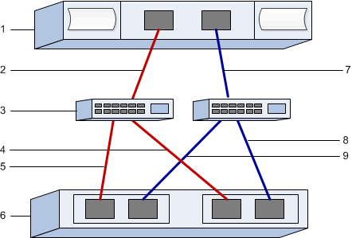

= E-Series에서 VMware용 FC 스위치 및 호스트 식별자 구성
:allow-uri-read: 
:icons: font
:imagesdir: ../media/

[role="lead"]
파이버 채널 프로토콜(FCP)을 사용하려면 스위치를 구성하고 호스트 포트 식별자를 결정해야 합니다.

NOTE: VMware와의 호환성을 확보하려면 4096바이트 드라이브를 사용할 때 볼륨을 512바이트 에뮬레이션(512e)을 사용하도록 설정해야 합니다. 볼륨을 512바이트 에뮬레이션(512e)을 사용하도록 설정하는 방법에 대한 자세한 내용은 SANtricity System Manager 온라인 도움말을 참조하십시오.

[[step-1-record-your-configuration]]
== 1단계: 구성 기록

이 페이지를 PDF 파일로 생성하여 인쇄한 다음, 아래 워크시트를 사용하여 FC 스토리지 구성 정보를 기록하십시오. 프로비저닝 작업을 수행할 때 이 정보가 필요합니다.

이 그림은 호스트가 두 개의 영역으로 나뉜 E-시리즈 스토리지 어레이에 연결된 모습을 보여줍니다. 한 영역은 빨간색 선으로, 다른 영역은 파란색 선으로 표시되어 있습니다. 각 영역에는 최소 하나의 이니시에이터 포트와 전체 타겟 포트의 절반이 포함됩니다. 호스트 및/또는 컨트롤러 포트 수는 호스트 버스 어댑터 수와 컨트롤러 모델에 따라 달라집니다. 컨트롤러당 최대 12개의 포트를 사용할 수 있습니다. 필요한 경우 추가 PDF 파일을 인쇄하십시오.

[[host-identifiers]]
=== 호스트 식별자입니다

|===
| 속성 표시기 번호 | 호스트(이니시에이터) 포트 접속입니다 | WWPN입니다 

 a| 
1
 a| 
호스트
 a| 
_해당 사항 없음 _

 a| 
2
 a| 
호스트 포트 0에서 FC 스위치 존 0으로
 a| 

 a| 
7
 a| 
호스트 포트 1에서 FC 스위치 존 1로
 a| 

|===

[[target-identifiers]]
=== 타겟 식별자

|===
| 속성 표시기 번호 | 어레이 컨트롤러(타겟) 포트 연결 | WWPN입니다 

 a| 
3
 a| 
스위치
 a| 
_해당 사항 없음 _

 a| 
6
 a| 
어레이 컨트롤러(타겟)
 a| 
_해당 사항 없음 _

 a| 
5
 a| 
컨트롤러 A, 포트 1에서 FC 스위치 1로
 a| 

 a| 
5
 a| 
컨트롤러 A, 2번 포트를 FC 스위치 1에 연결
 a| 

 a| 
9
 a| 
컨트롤러 A, 3번 포트를 FC 스위치 2에 연결
 a| 

 a| 
9
 a| 
컨트롤러 A, 4번 포트를 FC 스위치 2에 연결
 a| 

 a| 
4
 a| 
컨트롤러 B, 포트 1에서 FC 스위치 1로
 a| 

 a| 
4
 a| 
컨트롤러 B, FC 스위치 1에 연결된 포트 2
 a| 

 a| 
8
 a| 
컨트롤러 B, FC 스위치 2에 연결된 포트 3
 a| 

 a| 
8
 a| 
컨트롤러 B, FC 스위치 2에 연결된 포트 4
 a| 

|===

[[host-mapping-information]]
=== 호스트 매핑 정보

[cols="35h,~"]
|===
| 호스트 이름 매핑 중 |  

| 호스트 OS 유형입니다 |  
|===

[[step-2-determine-the-host-port-wwpns]]
== 2단계: 호스트 포트 WWPN 확인

FC 조닝을 구성하려면 각 이니시에이터 포트의 WWPN(Worldwide Port Name)을 확인해야 합니다.

.단계
. SSH 또는 ESXi 셸을 사용하여 ESXi 호스트에 연결합니다. ESXi 셸을 활성화하려면 https://knowledge.broadcom.com/external/article/311213/using-esxi-shell-in-esxi.html["ESXi에서 ESXi Shell 사용하기"^]을 참조하십시오.
. 다음 명령을 실행합니다.
+
[listing]
----
esxcli storage core adapter list
----
. 시작자의 WWPN 식별자(형식: fc.WWNN:WWPN의 UID)를 기록하십시오. 출력은 다음 예시와 유사합니다.
+
[listing]
----
HBA Name  Driver    Link State  UID                                   Capabilities         Description
--------  --------  ----------  ------------------------------------  -------------------  -----------
vmhba4    lpfc      link-up     fc.200070b7e4395530:100070b7e4395530  Second Level Lun ID  (0000:5e:00.0) Emulex Corporation Emulex LPe35000/LPe36000 Fibre Channel Adapter
vmhba5    lpfc      link-up     fc.200070b7e4395531:100070b7e4395531  Second Level Lun ID  (0000:5e:00.1) Emulex Corporation Emulex LPe35000/LPe36000 Fibre Channel Adapter
vmhba64   lpfc      link-up     fc.200070b7e4395530:100070b7e4395530                       (0000:5e:00.0) Emulex Corporation Emulex LPe35000/LPe36000 Fibre Channel Adapter
vmhba65   lpfc      link-up     fc.200070b7e4395531:100070b7e4395531                       (0000:5e:00.1) Emulex Corporation Emulex LPe35000/LPe36000 Fibre Channel Adapter

----

위 예시에서 vmhba4와 vmhba64, 그리고 vmhba5와 vmhba65의 UID는 동일합니다. 이는 FCP와 NVMe over FC를 모두 지원하는 FC 어댑터에서 예상되는 동작입니다. 각 고유한 WWPN을 기록하십시오.

NOTE: 또 다른 명령 옵션은 `esxcli storage san fc list`입니다. 이 옵션을 사용하면 더 자세한 정보와 WWPN이 콜론으로 구분된 16진수 형식으로 표시됩니다.

[[step-3-configure-the-fc-switches]]
== 3단계: FC 스위치 구성

FC(Fibre Channel) 스위치를 구성(조닝)하면 호스트가 스토리지에 접속하고 경로 수를 제한할 수 있습니다. 스위치의 관리 인터페이스를 사용하여 스위치를 조닝(Zoning)합니다.

.시작하기 전에
다음 사항을 확인하십시오.

* 스위치에 대한 관리자 자격 증명.
* 스위치에 연결된 각 호스트 이니시에이터 포트와 각 컨트롤러 타겟 포트의 WWPN입니다.

NOTE: 공급업체의 HBA 유틸리티를 사용하여 HBA를 업그레이드하고 HBA에 대한 특정 정보를 얻을 수 있습니다. HBA 유틸리티를 얻는 방법에 대한 지침은 공급업체 웹 사이트의 지원 섹션을 참조하십시오.

.이 작업에 대해
각 이니시에이터 포트는 해당하는 모든 타겟 포트와 함께 별도의 존에 있어야 합니다. 스위치 조닝에 대한 자세한 내용은 스위치 공급업체의 설명서를 참조하십시오.

.단계
. FC 스위치 관리 프로그램에 로그인한 다음 zoning 구성 옵션을 선택합니다.
. 첫 번째 호스트 이니시에이터 포트를 포함하고 이니시에이터와 동일한 FC 스위치에 연결되는 모든 타겟 포트를 포함하는 새 존을 생성합니다.
. 스위치에서 각 FC 호스트 이니시에이터 포트에 대해 추가 존 생성
. 영역을 저장한 다음 새로운 조닝 구성을 활성화합니다.

영역 구성에 대한 자세한 지침은 스위치 제조업체의 설명서를 참조하십시오.
