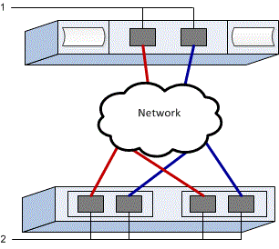

= E-Series에서 VMware용 NVMe over TCP 스위치 구성
:allow-uri-read: 
:icons: font
:imagesdir: ../media/

[role="lead"]
NVMe over TCP 프로토콜의 경우 스위치를 구성하고 호스트 NVMe 정규화 이름(NQN)을 확인합니다.

NOTE: VMware와의 호환성을 확보하려면 4096바이트 드라이브를 사용할 때 볼륨을 512바이트 에뮬레이션(512e)을 사용하도록 설정해야 합니다. 볼륨을 512바이트 에뮬레이션(512e)을 사용하도록 설정하는 방법에 대한 자세한 내용은 SANtricity System Manager 온라인 도움말을 참조하십시오.

[[step-1-record-your-configuration]]
== 1단계: 구성 기록

이 페이지를 PDF 파일로 생성하여 인쇄한 다음, 아래 워크시트를 사용하여 프로토콜별 스토리지 구성 정보를 기록하십시오. 프로비저닝 작업을 수행할 때 이 정보가 필요합니다.

이 그림은 VLAN 및/또는 고유 서브넷으로 분리된 E-시리즈 스토리지 어레이에 연결된 호스트를 보여줍니다. 파란색 선은 하나의 VLAN/서브넷을, 빨간색 선은 다른 VLAN/서브넷을 나타냅니다. 각 VLAN/서브넷에는 최소 하나의 이니시에이터 포트와 대상 포트의 절반이 포함됩니다. 호스트 및/또는 컨트롤러 포트 수는 네트워크 인터페이스 수와 컨트롤러 모델에 따라 달라집니다. 컨트롤러당 최대 6개의 포트를 사용할 수 있습니다.

[[host-mapping-information]]
=== 호스트 매핑 정보

[cols="35h,~"]
|===
| 호스트 이름 매핑 중 |  

| 호스트 OS 유형입니다 |  

| 호스트 NQN |  

| 타겟 NQN |  
|===

[[step-2-configure-the-nvmetcp-switches]]
== 2단계: NVMe/TCP 스위치 구성

NVMe over TCP에 대한 공급업체의 권장 사항에 따라 스위치를 구성합니다. 이러한 권장 사항에는 구성 지침과 코드 업데이트가 모두 포함될 수 있습니다.

.이 작업에 대해
이 작업에서는 NVMe over TCP에 대한 스위치 구성을 위한 일반적인 단계를 설명합니다. 자세한 내용은 스위치 제조업체의 설명서를 참조하십시오.

.시작하기 전에
다음 사항을 확인하십시오.

* 고가용성을 위한 두 개의 별도 네트워크. TCP를 통한 NVMe 트래픽을 서로 다른 네트워크 세그먼트로 분리해야 합니다.

.단계
스위치 공급업체의 설명서를 참조하십시오.

[[step-3-configure-networking]]
== 3단계: 네트워크 구성

데이터 저장 요구 사항에 따라 NVMe over TCP 네트워크를 구성하는 방법은 여러 가지가 있습니다. 환경에 가장 적합한 구성을 선택하는 방법에 대한 도움말은 네트워크 관리자에게 문의하십시오.

.이 작업에 대해
이 작업에서는 TCP를 통한 NVMe 네트워크 구성에 대한 일반적인 단계를 설명합니다. 자세한 내용은 스위치 제조업체의 설명서를 참조하십시오.

.시작하기 전에
다음 사항을 확인하십시오.

* 스위치가 TCP 트래픽용으로 구성되었습니다.

TCP를 통한 NVMe 네트워킹을 계획할 때,  https://configmax.broadcom.com/guest["VMware 구성 최대값 가이드"^]서버당 지원되는 최대 TCP NVMe 이니시에이터 포트는 2개라는 점을 기억하십시오. 너무 많은 경로를 구성하지 않도록 이 요구 사항을 반드시 고려해야 합니다.

원활한 다중 경로 구성을 위해 NVMe over TCP 네트워크에 여러 네트워크 세그먼트를 사용하십시오. 호스트 측 포트 하나 이상과 각 어레이 컨트롤러의 포트 하나 이상을 하나의 네트워크 세그먼트에 배치하고, 동일한 호스트 측 및 어레이 측 포트 그룹을 다른 네트워크 세그먼트에 배치하십시오. 가능한 경우 여러 개의 이더넷 스위치를 사용하여 추가적인 이중화를 제공하십시오.

.단계
스위치 공급업체의 설명서를 참조하십시오.

[[step-4-configure-array-side-networking]]
== 4단계: 어레이 측 네트워킹 구성

SANtricity System Manager 인터페이스를 사용하여 어레이 측에서 NVMe over TCP 네트워킹을 구성합니다.

.이 작업에 대해
이 작업에서는 SANtricity System Manager의 *컨트롤러 및 구성 요소* 페이지에서 NVMe over TCP 포트 구성에 액세스하는 방법을 설명합니다. SANtricity System Manager 내의 *NVMe over TCP 포트 구성* 페이지에서도 구성에 액세스할 수 있습니다.

.시작하기 전에
다음 사항을 확인하십시오.

* 스토리지 어레이 컨트롤러 중 하나의 IP 주소 또는 도메인 이름입니다.
* 시스템 관리자 GUI에 대한 암호, 역할 기반 액세스 제어(RBAC) 또는 LDAP 및 디렉터리 서비스가 스토리지 어레이에 대한 적절한 보안 액세스 권한을 위해 구성되어 있습니다. link:https://docs.netapp.com/us-en/e-series-santricity/um-certificates/overview-access-management-um.html["액세스 관리"^]에 대한 자세한 내용은 SANtricity 시스템 관리자 온라인 도움말을 참조하십시오.

.단계
. 브라우저에서 다음 URL을 입력합니다. https://<DomainNameOrIPAddress>[]
+
IPAddress는 스토리지 배열 컨트롤러 중 하나의 주소입니다.

+
구성되지 않은 어레이에서 SANtricity 시스템 관리자를 처음 열면 관리자 암호 설정 프롬프트가 나타납니다. 역할 기반 액세스 관리는 관리자, 지원, 보안 및 모니터링의 네 가지 로컬 역할을 구성합니다. 마지막 세 개의 역할에는 추측할 수 없는 임의의 암호가 있습니다. admin 역할의 암호를 설정한 후 admin 자격 증명을 사용하여 모든 암호를 변경할 수 있습니다. 4개의 로컬 사용자 역할에 대한 자세한 내용은 SANtricity 시스템 관리자 온라인 도움말을 참조하십시오.

. 관리자 암호 설정 및 암호 확인 필드에 관리자 역할에 대한 System Manager 암호를 입력한 다음 * 암호 설정 * 을 클릭합니다.
+
풀, 볼륨 그룹, 워크로드 또는 알림이 구성되어 있지 않으면 설정 마법사가 실행됩니다.

. 설정 마법사를 닫습니다.
+
나중에 마법사를 사용하여 추가 설정 작업을 완료합니다.

. * Hardware * > * Controllers and components * 를 선택하십시오.
. 구성하려는 NVMe over TCP 포트가 있는 컨트롤러를 클릭하십시오.
+
컨트롤러의 상황에 맞는 메뉴가 나타납니다.

. *TCP 포트를 통한 NVMe 구성*을 선택하십시오.
+
TCP 포트를 통한 NVMe 구성 대화 상자가 열립니다.

. 드롭다운 목록에서 구성할 포트를 선택한 후 * 다음 * 을 클릭합니다.
. 구성 포트 설정을 선택한 후 * 다음 * 을 클릭합니다.
+
모든 포트 설정을 보려면 대화 상자 오른쪽에 있는 * 추가 포트 설정 표시 * 링크를 클릭합니다.

+
|===
| 포트 설정 | 설명 

 a| 
이더넷 포트 속도를 구성했습니다
 a| 
원하는 속도를 선택하세요. 드롭다운 목록에 나타나는 옵션은 네트워크에서 지원할 수 있는 최대 속도에 따라 달라집니다(예: 200 Gb/s).

 a| 
IPv4 사용/IPv6 사용
 a| 
IPv4 및 IPv6 네트워크에 대한 지원을 활성화하려면 하나 또는 두 옵션을 모두 선택하십시오.

 a| 
MTU 크기(더 많은 포트 설정 표시를 클릭하면 사용 가능)
 a| 
필요한 경우 MTU(Maximum Transmission Unit)에 대한 새 크기를 바이트 단위로 입력합니다.

기본 최대 전송 단위(MTU) 크기는 프레임당 4200바이트입니다. 1500에서 9000 사이의 값을 입력해야 합니다.

|===
+
IPv4 사용 * 을 선택한 경우 * 다음 * 을 클릭하면 IPv4 설정을 선택할 수 있는 대화 상자가 열립니다. IPv6 사용 * 을 선택한 경우 * 다음 * 을 클릭하면 IPv6 설정을 선택할 수 있는 대화 상자가 열립니다. 두 옵션을 모두 선택한 경우 IPv4 설정에 대한 대화 상자가 먼저 열리고 * 다음 * 을 클릭하면 IPv6 설정에 대한 대화 상자가 열립니다.

+
IPv4 및/또는 IPv6 설정을 자동 또는 수동으로 구성합니다. 모든 포트 설정을 보려면 대화 상자 오른쪽에 있는 * 추가 설정 표시 * 링크를 클릭합니다.

+
|===
| 포트 설정 | 설명 

 a| 
자동으로 구성을 가져옵니다
 a| 
구성을 자동으로 가져오려면 이 옵션을 선택합니다.

 a| 
수동으로 정적 설정을 지정합니다
 a| 
이 옵션을 선택한 다음 필드에 정적 주소를 입력합니다. IPv4의 경우 네트워크 서브넷 마스크 및 게이트웨이를 포함합니다. IPv6의 경우 라우팅 가능한 IP 주소와 라우터 IP 주소를 포함합니다.

|===
. 마침 * 을 클릭합니다.
. System Manager를 닫습니다.

[[step-5-configure-host-side-networking]]
== 5단계: 호스트 측 네트워킹 구성

호스트 측에서 TCP를 통한 NVMe 네트워킹을 구성하면 VMware NVMe over TCP 스토리지 어댑터 이니시에이터가 어레이와 세션을 설정할 수 있습니다.

.단계
. TCP 네트워크 어댑터를 식별하고 vmnic 페어링된 업링크를 기록합니다.
+
호스트의 네트워크 어댑터는 vmnicN으로 명명되며, 여기서 N은 네트워크 어댑터를 식별하는 고유 번호입니다(예: vmnic0, vmnic1 등). 물리적 어댑터는 ESXi 호스트의 네트워킹 메뉴에서 보거나, 호스팅 vCenter의 인벤토리에서 ESXi 호스트를 선택한 후 구성 탭에서 볼 수 있습니다.

. vSphere 표준 스위치를 사용하여 TCP 어댑터에 대한 VMkernel 포트 바인딩을 구성합니다.
+
자세한 내용은 link:https://techdocs.broadcom.com/us/en/vmware-cis/vsphere/vsphere/9-1/vsphere-storage/about-vmware-nvme-storage/configuring-nvme-over-tcp-on-esxi/configure-vmkernel-binding-for-the-tcp-adapter.html["TCP 어댑터에 대한 VMkernel 바인딩을 구성합니다"^]을 참조하십시오.

. 소프트웨어 NVMe over TCP 어댑터를 추가합니다.
+
자세한 내용은 link:https://techdocs.broadcom.com/us/en/vmware-cis/vsphere/vsphere/9-1/vsphere-storage/about-vmware-nvme-storage/configuring-nvme-over-tcp-on-esxi/configure-vmkernel-binding-for-the-tcp-adapter/configure-vmkernel-binding-for-the-tcp-adapter-with-a-vsphere-standard-switch.html["RDMA를 통한 소프트웨어 NVMe 또는 TCP를 통한 NVMe 어댑터 추가"^]을 참조하십시오.

. TCP를 통한 NVMe용 NVMe 컨트롤러를 추가합니다.
+
자세한 내용은 link:https://techdocs.broadcom.com/us/en/vmware-cis/vsphere/vsphere/9-1/vsphere-storage/about-vmware-nvme-storage/configuring-nvme-over-tcp-on-esxi/shared-content/submaps/GUID-23E6D699-BEDC-4B5F-9515-3390C0E73888_copy.html["NVMe over Fabrics용 컨트롤러 추가"^]을 참조하십시오.

NOTE: 호스트 NQN은 이 과정에서 컨트롤러 추가 대화 상자에서 얻을 수 있습니다. 이 정보는 나중에 호스트 매핑을 구성할 때 필요합니다.

추가가 성공적으로 완료되면 vSphere Client의 스토리지 어댑터 보기에서 연결을 확인할 수 있습니다. 연결에 실패한 경우 6단계로 이동하여 포트와의 통신을 확인하고 연결 설정을 수정하십시오.

[[step-6-verify-ip-network-connections]]
== 6단계: IP 네트워크 연결 확인

ping 테스트를 사용하여 호스트와 어레이가 통신할 수 있는지 확인하여 IP(인터넷 프로토콜) 네트워크 연결을 확인합니다.

.단계
. 호스트에서 다음 명령을 실행하십시오.
+
[listing]
----
vmkping <NVMe over TCP_target_IP_address\>
----
+
이 예에서 TCP를 통한 NVMe의 타겟 IP 주소는 192.29.11.111입니다.

+
[listing]
----
vmkping -d 192.29.11.111
PING 192.29.11.111 (192.29.11.111): 56 data bytes
64 bytes from 192.29.11.111: icmp_seq=0 ttl=64 time=0.902 ms
64 bytes from 192.29.11.111: icmp_seq=1 ttl=64 time=0.406 ms
64 bytes from 192.29.11.111: icmp_seq=2 ttl=64 time=0.855 ms
--- 192.29.11.111 ping statistics ---
3 packets transmitted, 3 packets received, 0% packet loss
round-trip min/avg/max = 0.406/0.721/0.902 ms
----
. 각 호스트의 이니시에이터 주소(TCP를 통한 NVMe에 사용되는 호스트 이더넷 포트의 IP 주소)에서 각 컨트롤러의 TCP를 통한 NVMe 포트로 `vmkping` 명령을 실행합니다. 구성의 각 호스트 서버에서 필요에 따라 IP 주소를 변경하여 이 작업을 수행합니다.
+

NOTE: 명령이  `sendto() failed (Message too long)` 메시지와 함께 실패하면 호스트 서버, 스토리지 컨트롤러 및 스위치 포트의 이더넷 인터페이스에 대한 MTU 크기를 확인하십시오.

. 5단계 검색이 실패한 경우, NVMe over TCP 호스트 측 네트워킹 구성 절차로 돌아가 타겟 컨트롤러 추가를 완료하십시오.

