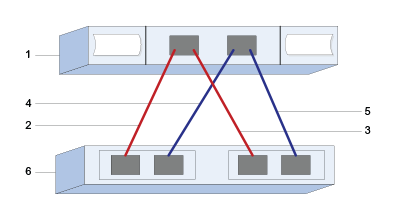

= E-Series에서 VMware용 SAS 호스트 포트 및 설정 구성
:allow-uri-read: 
:icons: font
:imagesdir: ../media/

[role="lead"]
SAS 프로토콜의 경우 호스트 포트 주소를 확인하고 권장 설정을 구성합니다.

[[step-1-record-your-configuration]]
== 1단계: 구성 기록

이 페이지를 PDF 파일로 생성하여 인쇄한 다음, 아래 워크시트를 사용하여 프로토콜별 스토리지 구성 정보를 기록하십시오. 프로비저닝 작업을 수행할 때 이 정보가 필요합니다.

이 그림은 이중화된 연결(4포트 SAS HBA를 가정)을 통해 E-시리즈 스토리지 어레이에 직접 연결된 호스트를 보여줍니다. 첫 번째 이중화 연결은 빨간색 선으로, 두 번째 이중화 연결은 파란색 선으로 표시됩니다. 포트 수는 호스트 포트 수에 따라 달라집니다. 호스트 포트가 2개뿐일 수 있습니다. 이 경우, 최소한 첫 번째 이중화 연결을 권장합니다.

[[host-identifiers]]
=== 호스트 식별자입니다

|===
| 속성 표시기 번호 | 호스트(이니시에이터) 포트 접속입니다 | SAS 주소입니다 

 a| 
1
 a| 
호스트
 a| 
_해당 사항 없음 _

 a| 
2
 a| 
컨트롤러 A, 포트 1에 연결된 호스트(이니시에이터) 포트 1
 a| 

 a| 
3
 a| 
컨트롤러 B, 포트 1에 연결된 호스트(이니시에이터) 포트 2
 a| 

 a| 
4
 a| 
호스트(시작자)의 3번 포트가 컨트롤러 A의 1번 포트에 연결됩니다.
 a| 

 a| 
5
 a| 
호스트(이니시에이터) 포트 4가 컨트롤러 B, 포트 1에 연결됩니다.
 a| 

|===

[[host-mapping-information]]
=== 호스트 매핑 정보

[cols="35h,~"]
|===
| 호스트 이름 매핑 중 |  

| 호스트 OS 유형입니다 |  
|===

[[step-2-determine-sas-host-identifiers]]
== 2단계: SAS 호스트 식별자 확인

esxcli 또는 HBA 유틸리티를 사용하여 SAS 주소를 찾으십시오.

.이 작업에 대해
HBA 유틸리티에 대한 지침을 검토합니다.

* 대부분의 HBA 공급업체는 HBA 유틸리티를 제공합니다.

.단계
. SSH 또는 ESXi 셸을 사용하여 ESXi 호스트에 연결합니다. ESXi 셸을 활성화하려면 https://knowledge.broadcom.com/external/article/311213/using-esxi-shell-in-esxi.html["ESXi에서 ESXi Shell 사용하기"^]을 참조하십시오.
. 다음 명령을 실행합니다.
+
[listing]
----
esxcli storage core adapter list
----
. 시작자 SAS 주소 식별자(UID, 형식: sas.<SAS_Address>)를 기록하십시오. 출력은 다음 예시와 유사합니다.
+
[listing]
----
HBA Name  Driver       Link State  UID                   Capabilities         Description
--------  ----------   ----------  --------------------  -------------------  -----------
vmhba1    lsi_msgpt35  link-n/a    sas.5b083fe0ca0e7000                       (0000:03:00.0) Avago (LSI Logic) SAS3008 12Gbps SAS HBA external
----

위 예시에서 UID는 기본 SAS 주소만 표시합니다. 다른 포트의 경우, 처음 14자는 고정되어 있고 마지막 두 자리만 포트를 나타내기 위해 달라집니다. 일반적으로 마지막 자리는 각 포트마다 1씩 증가합니다. E-Series 어레이는 호스트 매핑 중에 다른 포트의 SAS 주소를 자동으로 감지하여 선택할 수 있도록 목록에 표시하므로, 기본 SAS 주소만으로도 호스트 어댑터를 식별하는 데 충분합니다. 각 포트의 SAS 주소를 얻으려면 벤더에서 제공하는 HBA 유틸리티를 사용하는 것이 도움이 될 수 있습니다.

NOTE: 또 다른 명령 옵션은 `esxcli storage san sas list`입니다. 이 옵션을 사용하면 더 자세한 정보와 기본 SAS 주소가 콜론으로 구분된 16진수 형식으로 표시됩니다.
