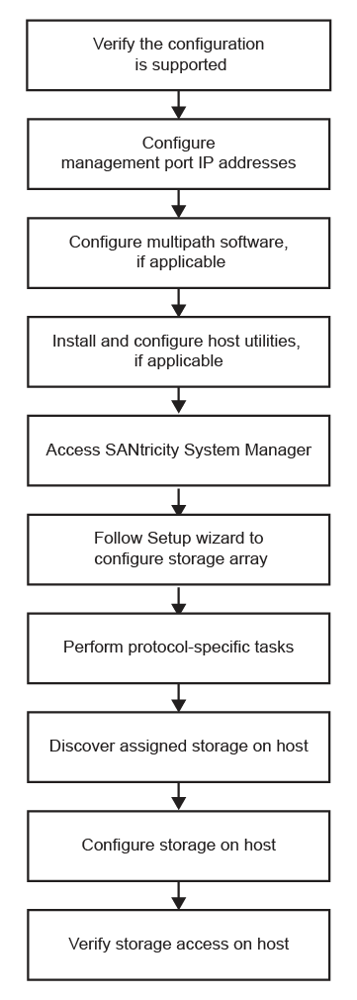

= E-Series용 VMware Express 구성 워크플로
:allow-uri-read: 
:icons: font
:imagesdir: ../media/

[role="lead"]
이 워크플로우에서는 스토리지 시스템과 SANtricity System Manager를 구성하여 스토리지를 VMware 호스트에서 사용할 수 있도록 하는 "빠른 방법"을 안내합니다.

