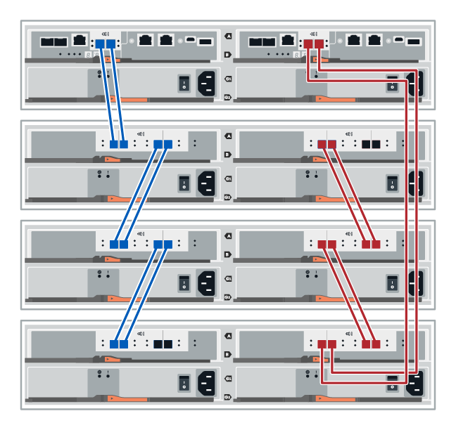
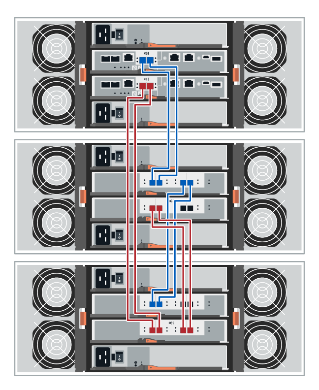
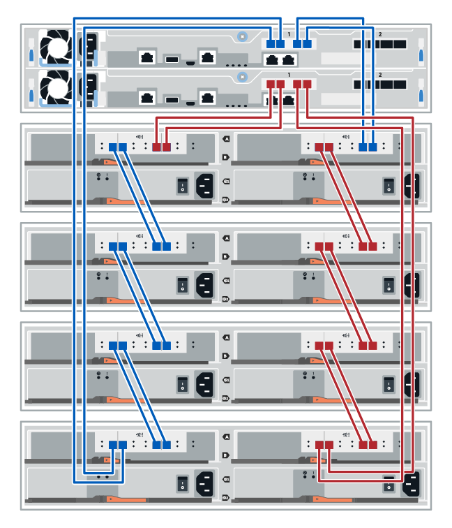
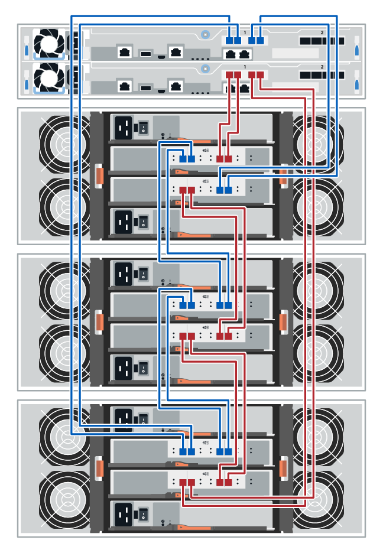
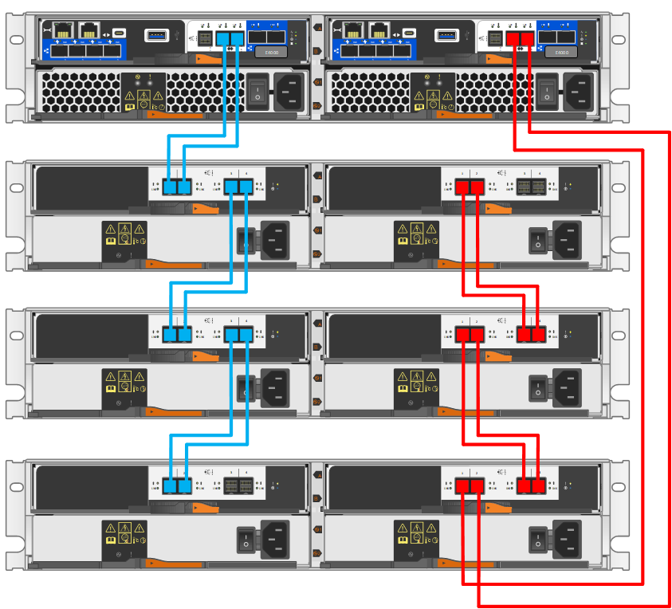
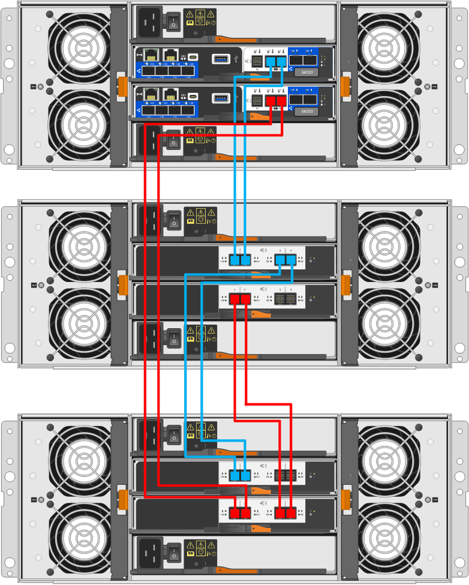

= E-Series 컨트롤러 셸프를 드라이브 셸프에 케이블로 연결합니다.
:allow-uri-read: 
:icons: font
:imagesdir: ../media/

[role="lead"]
컨트롤러 쉘프의 각 컨트롤러를 드라이브 쉘프의 I/O 모듈(IOM)에 연결해야 합니다.

.이 작업에 대해
* 이 절차는 IOM12, IOM12B, IOM12C 드라이브 선반에 적용됩니다.
+

NOTE: IOM12C 모듈은 SANtricity OS 11.90R3 이상에서만 지원됩니다. IOM12C를 설치하거나 업그레이드하기 전에 컨트롤러의 펌웨어가 업데이트되었는지 확인합니다.

* 구형 컨트롤러 쉘프를 DE212C, DE224C 또는 DE460에 케이블로 연결하는 경우 를 참조하십시오 https://mysupport.netapp.com/ecm/ecm_download_file/ECMLP2859057["기존 E27XX, E56XX 또는 EF560 컨트롤러 쉘프에 IOM 드라이브 쉘프를 추가합니다"^].
* 새 시스템 설치의 일환으로 EF50 또는 EF80 스토리지 시스템을 SAS 확장 셸프에 케이블로 연결하는 경우 link:../install-hw-ef50-ef80/install-cable.html["EF50 및 EF80 스토리지 시스템의 하드웨어 케이블 연결"] 절차를 참조하십시오.

[[cabling-e2800-and-e5700]]
== E2800 및 E5700 케이블 연결

다음 정보는 E2800, E2800B, EF280, E5700, EF5700B 케이블 연결에 적용됩니다. 또는 EF570 컨트롤러 쉘프: DE212C, DE224C 또는 DE460 드라이브 쉘프

[role="tabbed-block"]
====
.12-드라이브 또는 24-드라이브 쉘프
--
컨트롤러 쉘프를 하나 이상의 12 드라이브 또는 24 드라이브 쉘프에 연결할 수 있습니다.

다음 이미지는 컨트롤러 쉘프와 드라이브 쉘프를 나타냅니다. 모델에서 포트를 찾으려면 를 참조하십시오 https://hwu.netapp.com/Controller/Index?platformTypeId=2357027["Hardware Universe"^].

--
.60-드라이브 쉘프
--
컨트롤러 쉘프를 하나 이상의 60-드라이브 쉘프에 연결할 수 있습니다.

다음 이미지는 컨트롤러 쉘프와 드라이브 쉘프를 나타냅니다. 모델에서 포트를 찾으려면 를 참조하십시오 https://hwu.netapp.com/Controller/Index?platformTypeId=2357027["Hardware Universe"^].

--
====

[[cabling-ef300-and-ef600]]
== EF300 및 EF600 케이블 연결

다음 정보는 EF300, EF600, EF300C 또는 EF600C 컨트롤러 쉘프를 DE212C, DE224C 또는 DE460 드라이브 쉘프에 연결하는 데 적용됩니다.

.시작하기 전에
EF300 또는 EF600을 케이블로 연결하기 전에 펌웨어를 최신 버전으로 업데이트해야 합니다. 펌웨어를 업데이트하려면 의 지침을 따르십시오 link:../upgrade-santricity/index.html["SANtricity OS 업그레이드 중"^].

[role="tabbed-block"]
====
.12-드라이브 또는 24-드라이브 쉘프
--
컨트롤러 쉘프를 하나 이상의 12 드라이브 또는 24 드라이브 쉘프에 연결할 수 있습니다.

다음 이미지는 컨트롤러 쉘프와 드라이브 쉘프를 나타냅니다. 모델에서 포트를 찾으려면 를 참조하십시오 https://hwu.netapp.com/Controller/Index?platformTypeId=2357027["Hardware Universe"^].

--
.60-드라이브 쉘프
--
컨트롤러 쉘프를 하나 이상의 60-드라이브 쉘프에 연결할 수 있습니다.

다음 이미지는 컨트롤러 쉘프와 드라이브 쉘프를 나타냅니다. 모델에서 포트를 찾으려면 를 참조하십시오 https://hwu.netapp.com/Controller/Index?platformTypeId=2357027["Hardware Universe"^].

--
====

[[cabling-e4000]]
== E4000 케이블 연결

다음 정보는 E4000 컨트롤러 쉘프를 DE212C, DE224C 또는 DE460 드라이브 쉘프에 연결하는 데 적용됩니다.

[role="tabbed-block"]
====
.12-드라이브 쉘프
--
컨트롤러 쉘프를 하나 이상의 12-드라이브 쉘프에 연결할 수 있습니다.

--
.60-드라이브 쉘프
--
컨트롤러 쉘프를 하나 이상의 60-드라이브 쉘프에 연결할 수 있습니다.

--
====