= E-Series 스토리지 시스템에서 드라이브 쉘프 핫 추가
:allow-uri-read: 
:icons: font
:imagesdir: ../media/

[role="lead"]
스토리지 시스템 컨트롤러에 사용 가능한 SAS 포트가 이미 있는 경우, 스토리지 시스템의 다른 구성 요소에 전원이 공급되는 동안에도 새 드라이브 셸프를 추가할 수 있습니다. 사용자의 데이터 액세스를 중단하지 않고 스토리지 시스템 용량을 구성, 재구성, 추가 또는 재배치할 수 있습니다.

.시작하기 전에
* 이 절차는 복잡하므로 시작하기 전에 모든 단계를 꼼꼼히 읽어 주십시오.
+
기존 셸프 하나 이상에 셸프를 핫 추가하는 경우, 절차 진행 중 시스템 무결성을 유지하려면 항상 활성 경로 하나를 유지해야 합니다. 제시된 순서대로 절차를 정확히 따라야 합니다.

+
새 쉘프를 케이블링하려면 A측(쉘프 IOM A) 컨트롤러-쉘프 연결을 다시 케이블링하고 쉘프 간 연결을 추가한 다음 A측 경로가 활성화되었는지 확인합니다. 그런 다음 B측(쉘프 IOM B) 컨트롤러-쉘프 연결을 다시 케이블링하고 쉘프 간 연결을 추가한 후 이중화가 다시 설정되었는지 확인합니다.

+

NOTE: 이전에 스토리지 시스템에 설치된 드라이브 쉘프를 설치하는 경우, 이 절차에는 추가로 수행해야 하는 단계가 있습니다.

* 필요한 경우 드라이브 쉘프 핫 추가가 반드시 필요합니다.
* 스토리지 시스템이 SAS 확장 쉘프를 지원하는 SANtricity 버전을 실행 중인지, 그리고 지원되는 SAS 쉘프의 최대 개수를 초과하지 않았는지 확인하십시오.
+
SANtricity의 지원되는 버전 및 스토리지 시스템에 지원되는 최대 SAS 확장 쉘프 수에 대한 자세한 내용은 NetApp Hardware Universe를 참조하십시오: https://hwu.netapp.com/Controller/Index?platformTypeId=2357027["Hardware Universe"^].

+

NOTE: SANtricity 12.10 이상을 실행하는 EF50 및 EF80 스토리지 시스템은 SAS 확장 쉘프를 지원합니다.

* 스토리지 시스템에 사용 가능한 SAS 포트가 있어야 합니다. 즉, SAS I/O 모듈이 이미 설치되어 있어야 합니다. 설치되어 있지 않은 경우, 해당 절차에 따라 SAS I/O 모듈을 설치한 다음, 이 절차로 돌아와 드라이브 셸프를 핫 애드하십시오.
+
** EF50 및 EF80 스토리지 시스템의 경우 link:../maintenance-ef50-ef80/io-module-upgrade.html["I/O 모듈 업그레이드"^] 절차를 사용하십시오.
** 기존 스토리지 시스템의 경우, _시스템 유지 관리_ 섹션에서 해당 스토리지 시스템 모델에 맞는 _SAS 확장 카드_ 절차를 사용하십시오.

.이 작업에 대해
* 이 절차는 E2800, E2800B, EF280, E5700, E5700B, EF570, EF300, EF600, EF300C, EF600C, E4000, EF50 또는 EF80 컨트롤러 셸프에 적용됩니다.
+

NOTE: 구형 컨트롤러 쉘프에 케이블을 연결하는 경우 다음을 참조하십시오 https://mysupport.netapp.com/ecm/ecm_download_file/ECMLP2859057["기존 E27XX, E56XX 또는 EF560 컨트롤러 쉘프에 IOM 드라이브 쉘프를 추가합니다"^].

* 이 절차는 IOM12, IOM12B 또는 IOM12C 모듈이 장착된 DE212C, DE224C 또는 DE460C 드라이브 쉘프를 핫 추가할 때 적용됩니다.
+

NOTE: IOM12C 모듈은 SANtricity OS 11.90R3 이상에서만 지원됩니다. IOM12C를 설치하거나 업그레이드하기 전에 컨트롤러의 펌웨어가 업데이트되었는지 확인합니다.

[[step-1-prepare-to-add-the-drive-shelf]]
== 1단계: 드라이브 쉘프 추가를 준비합니다

드라이브 쉘프를 핫 애드할 준비를 하려면 중요 이벤트를 확인하고 IOM 상태를 확인해야 합니다.

.시작하기 전에
* 스토리지 시스템의 전원을 새 드라이브 쉘프의 전원 요구사항을 수용할 수 있어야 합니다. 드라이브 쉘프의 전원 사양은 을 참조하십시오 https://hwu.netapp.com/Controller/Index?platformTypeId=2357027["Hardware Universe"^].
* 기존 스토리지 시스템의 케이블 연결 패턴은 이 절차에서 설명하는 적용 가능한 구성표 중 하나와 일치해야 합니다.

.단계
. SANtricity 시스템 관리자에서 * 지원 * > * 지원 센터 * > * 진단 * 을 선택합니다.
. 지원 데이터 수집 * 을 선택합니다.
+
지원 데이터 수집 대화 상자가 나타납니다.

. 수집 * 을 클릭합니다.
+
파일은 브라우저의 다운로드 폴더에 support-data.7z라는 이름으로 저장됩니다. 데이터가 기술 지원 부서에 자동으로 전송되지 않습니다.

. 지원 * > * 이벤트 로그 * 를 선택합니다.
+
이벤트 로그 페이지에는 이벤트 데이터가 표시됩니다.

. 중요 이벤트를 목록 맨 위로 정렬하려면 * Priority * 열의 머리글을 선택합니다.
. 지난 2-3주 동안 발생한 이벤트에 대해 시스템 중요 이벤트를 검토하고 최근 중요 이벤트가 해결되었거나 기타 방법으로 해결되었는지 확인합니다.
+

NOTE: 이전 2-3주 내에 해결되지 않은 중요 이벤트가 발생한 경우 절차를 중지하고 기술 지원 부서에 문의하십시오. 문제가 해결된 경우에만 절차를 계속합니다.

. 하드웨어에 IOM이 연결되어 있는 경우 다음 단계를 수행하십시오. 그렇지 않으면 로 이동합니다 <<step2_install_drive_shelf,2단계: 드라이브 쉘프를 설치하고 전원을 공급합니다.>>
+
.. 메뉴: Hardware[Controllers and components]를 선택합니다.
.. IOM(ESM) * 아이콘을 선택합니다.
+
image::../media/sam1130_ss_hardware_iom_icon.gif[IOM(ESM) 아이콘]

+
Shelf Component Settings 대화 상자가 * IOMs(ESM) * 탭이 선택된 상태로 나타납니다.

.. 각 IOM/ESM에 대해 표시된 상태가 _Optimal_인지 확인합니다.
.. 추가 설정 표시 * 를 클릭합니다.
.. 다음 조건이 존재하는지 확인하십시오.
+
*** 감지된 ESM의 수는 시스템에 설치된 ESM 수와 각 드라이브 쉘프에 대한 ESM의 수와 일치합니다.
*** 두 ESM 모두 통신이 정상임을 나타냅니다.
*** 데이터 속도는 DE212C, DE224C 및 DE460C 드라이브 쉘프의 12Gb/s이고 기타 드라이브 트레이의 경우 6Gb/s입니다.

[[step-2-install-the-drive-shelf-and-apply-power]]
[[step2_install_drive_shelf]]
== 2단계: 드라이브 쉘프를 설치하고 전원을 켭니다

새 드라이브 쉘프 또는 이전에 설치된 드라이브 쉘프를 설치하고 전원을 켠 다음 주의가 필요한 LED가 있는지 확인합니다.

.단계
. 이전에 스토리지 시스템에 설치된 드라이브 쉘프를 설치하는 경우, 드라이브를 제거하십시오. 이 절차의 뒷부분에서 드라이브를 한 번에 하나씩 설치해야 합니다.
+
설치하려는 드라이브 쉘프의 설치 기록을 알 수 없는 경우, 이전에 스토리지 시스템에 설치된 것으로 가정해야 합니다.

. 스토리지 시스템 구성 요소를 보관하는 랙에 드라이브 쉘프를 설치합니다.
+

NOTE: 실제 설치 및 전원 케이블 연결에 대한 전체 절차는 해당 모델의 설치 지침을 참조하십시오. 해당 모델의 설치 지침에는 드라이브 쉘프를 안전하게 설치하기 위해 고려해야 하는 참고 사항 및 경고가 포함되어 있습니다.

. 새 드라이브 쉘프의 전원을 켜고 드라이브 쉘프에 있는 주황색 주의 LED가 켜져 있지 않은지 확인합니다. 가능한 경우 이 절차를 계속하기 전에 모든 고장 상태를 해결하십시오.

[[step-3-cable-the-drive-shelf]]
== 3단계: 드라이브 셸프에 케이블을 연결합니다.

쉘프를 스토리지 시스템에 케이블로 연결하려면 각 컨트롤러가 단일 쉘프 또는 쉘프 스택(해당되는 경우)에 대한 A측 경로(IOMA)와 B측 경로(IOMB)를 갖도록 연결합니다. 쉘프 스택이 있는 경우, A측 경로와 B측 경로를 통해 쉘프들을 서로 연결(쉘프 간 연결)합니다.

컨트롤러와 하나 이상의 쉘프를 연결할 때는 항상 케이블 연결 그림에 표시된 것처럼 A측 경로(IOMA)와 B측 경로(IOMB)에 각각 두 개의 케이블 연결이 되도록 해야 합니다.

[role="tabbed-block"]
====
.EF50 또는 EF80용 드라이브 셸프 연결
--
이 절차는 EF50 또는 EF80 스토리지 시스템에 초기 SAS 확장 쉘프를 핫 추가하는 방법과 두 번째 쉘프를 핫 추가하기 위해 초기 쉘프의 케이블을 다시 연결하는 방법을 안내합니다. 하지만 이 절차는 추가 쉘프를 추가할 때도 적용할 수 있습니다.

.시작하기 전에
펌웨어를 최신 버전으로 업데이트했습니다. 펌웨어를 업데이트하려면 의 지침을 따르십시오 link:../upgrade-santricity/index.html["SANtricity OS 업그레이드 중"].

.이 작업에 대해
* 기존 쉘프 하나 이상에 추가 쉘프를 핫 추가하는 경우 다음이 적용됩니다.
+
** 이 절차에서는 컨트롤러 쉘프에 대한 활성 경로를 항상 하나 유지할 수 있도록 컨트롤러-쉘프 연결을 다시 케이블로 연결합니다.
+
이 절차 동안 활성 경로 하나를 유지하려면 A측(쉘프 IOMA) 컨트롤러-쉘프 연결을 다시 케이블링하고 쉘프 간 연결을 추가한 다음 A측 경로가 활성화되었는지 확인하고, B측(쉘프 IOMB) 컨트롤러-쉘프 연결을 다시 케이블링하고 쉘프 간 연결을 추가한 후 이중화가 다시 설정되었는지 확인합니다.

** 항상 스택의 맨 마지막 쉘프에서 새 쉘프의 동일한 IOM 및 IOM 포트로 케이블을 옮긴 다음 새 쉘프를 스택의 이전 맨 마지막 쉘프에 연결합니다(쉘프 간 연결).

* 이 절차는 최대 두 개의 쉘프를 핫 추가하는 단계를 설명합니다. 하지만 쉘프를 하나 더 핫 추가하려면 2단계부터 시작하여 추가 쉘프에 동일한 단계를 적용하십시오.
* 이 절차는 슬롯 3에 SAS I/O 모듈이 하나 장착된 컨트롤러를 보여줍니다. 지원되는 모든 SAS I/O 모듈 구성을 보려면 link:https://hwu.netapp.com["NetApp Hardware Universe를 참조하십시오"^]을 참조하십시오.
* 케이블 연결 그림에서 컨트롤러 A 연결은 파란색으로, 컨트롤러 B 연결은 빨간색으로 표시됩니다. 점선(파란색과 빨간색)은 케이블 연결 작업을 위해 이동해야 하는 기존 케이블을 나타냅니다. 회색 포트와 선은 케이블 연결 작업을 하는 동안 제자리에 그대로 유지되는 기존 케이블을 나타냅니다.

.단계
. 초기 SAS 확장 쉘프인 SAS 쉘프 하나를 핫 추가하려면 다음 하위 단계를 완료하십시오. 그렇지 않으면 다음 단계로 이동하십시오.
+
.. 컨트롤러 A의 3a 포트를 쉘프 IOMA의 1번 포트에 연결합니다.
.. 컨트롤러 A 포트 3b를 셸프 IOMA 포트 2에 연결합니다.
.. 컨트롤러 A 포트 3c를 셸프 IOMB 포트 3에 연결합니다.
.. 컨트롤러 A 포트 3d를 셸프 IOMB 포트 4에 연결합니다.
.. 컨트롤러 B 포트 3a를 쉘프 IOMA 포트 3에 연결합니다.
.. 컨트롤러 B 포트 3b를 쉘프 IOMA 포트 4에 연결합니다.
.. 컨트롤러 B 포트 3c를 쉘프 IOMB 포트 1에 연결합니다.
.. 컨트롤러 B 포트 3d를 쉘프 IOMB 포트 2에 연결합니다.
+
쉘프에 케이블 연결을 완료하면 케이블 연결은 다음과 같이 표시됩니다.

+
image::../media/drw_ef50-ef80_1_de460c_cabling_ieops-2981.svg[초기 쉘프에 케이블 연결]

. 두 번째 SAS 확장 쉘프(쉘프 2)를 핫 추가하려면 다음과 같이 A측 컨트롤러-쉘프 연결 케이블을 다시 연결하고 A측 쉘프-쉘프 연결을 추가하십시오. 그렇지 않으면 다음 단계로 진행하십시오.
+
.. 쉘프 1 IOMA 포트 1에서 케이블을 분리한 다음 쉘프 2 IOMA 포트 1에 다시 연결하십시오.
.. 쉘프 1 IOMA 포트 2에서 케이블을 분리한 다음 쉘프 2 IOMA 포트 2에 다시 연결하십시오.
.. 쉘프 1 IOMA 포트 1을 쉘프 2 IOMA 포트 4에 연결하십시오.
.. 쉘프 1 IOMA 포트 2를 쉘프 2 IOMA 포트 3에 연결하십시오.
+
A측 연결 케이블 재배선이 완료되면 케이블은 다음과 같이 보일 것입니다.

+
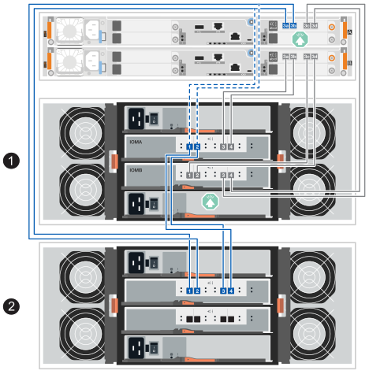

. SANtricity System Manager에서 menu:Hardware[Controllers and components]를 클릭합니다.
+

NOTE: 두 번째 SAS 확장 쉘프를 추가하는 경우, 이 절차 단계에서는 컨트롤러 쉘프에 대한 활성 경로가 하나만 있습니다.

. 필요에 따라 아래로 스크롤하여 새 스토리지 시스템의 모든 드라이브 쉘프를 확인합니다. 새 드라이브 쉘프가 표시되지 않으면 연결 문제를 해결하십시오.
. 새 드라이브 쉘프의 * ESM * 아이콘을 선택합니다.
+
image::../media/sam1130_ss_hardware_iom_icon.gif[ESM/IOM 아이콘]

+
Shelf Component Settings * 대화 상자가 나타납니다.

. Shelf Component Settings * 대화 상자에서 * ESM/IOMs * 탭을 선택합니다.
. 더 많은 옵션 표시 * 를 선택하고 다음을 확인합니다.
+
** 초기 SAS 확장 쉘프를 추가하는 경우 IOM/ESM A와 IOM/ESM B가 나열됩니다. 두 번째 SAS 확장 쉘프를 추가하는 경우 IOM/ESM A가 나열됩니다.
** SAS-3 드라이브 쉘프의 현재 데이터 속도는 12GBps입니다.
** 카드 통신이 정상입니다.

. 두 번째 SAS 확장 쉘프를 추가하는 경우 B측 컨트롤러-셸프 연결 케이블을 다시 연결하고 다음과 같이 B측 셸프-셸프 연결을 추가하십시오. 그렇지 않으면 10단계로 이동하십시오.
+
.. 쉘프 1 IOMB 포트 1에서 케이블을 분리한 다음 쉘프 2 IOMB 포트 1에 다시 연결하십시오.
.. 쉘프 1 IOMB 포트 2에서 케이블을 분리한 다음 쉘프 2 IOMB 포트 2에 다시 연결하십시오.
.. 쉘프 1 IOMB 포트 1을 쉘프 2 IOMB 포트 3에 연결하십시오.
.. 쉘프 1 IOMB 포트 2를 쉘프 2 IOMB 포트 4에 연결하십시오.
+
B측 연결 케이블 재배선이 완료되면 케이블은 다음과 같이 보여야 합니다.

+
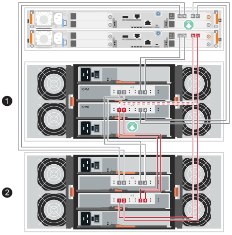

. 두 번째 SAS 확장 쉘프를 추가하는 경우, 두 쉘프의 케이블 재배선이 완료되면 케이블링은 다음과 같은 모습이 되어야 합니다.
+

NOTE: 기존 2개의 쉘프 스택에 3번째 쉘프를 핫 추가하는 경우, 케이블 연결은 새 시스템 설치를 위한 _SAS 쉘프 연결 케이블링_ 섹션의 link:../install-hw-ef50-ef80/install-cable.html#step-3-cable-the-sas-shelf-connections["옵션 2: DE460C 쉘프 3개 탭"^] 그림과 같아야 합니다.

+
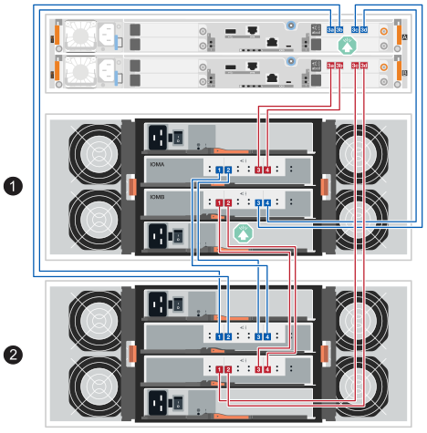

. 아직 선택하지 않은 경우 * Shelf Component Settings * 대화 상자에서 * ESM/IOMs * 탭을 선택한 다음 * Show More options * 를 선택합니다. 카드 통신이 * 예 * 인지 확인합니다.
+

NOTE: Optimal(최적) 상태는 새 드라이브 쉘프와 관련된 이중화 오류가 해결되었으며 스토리지 시스템이 안정화되었음을 나타냅니다.

--
.E2800 또는 E5700을 위한 드라이브 쉘프를 연결합니다
--
드라이브 쉘프를 컨트롤러 A에 연결하고 IOM 상태를 확인한 다음, 드라이브 쉘프를 컨트롤러 B에 연결합니다

.단계
. 드라이브 쉘프를 컨트롤러 A에 연결합니다
+
다음 그림은 추가 드라이브 쉘프와 컨트롤러 A 사이의 연결 예를 보여줍니다 모델에서 포트를 찾으려면 을 참조하십시오 https://hwu.netapp.com/Controller/Index?platformTypeId=2357027["Hardware Universe"^].

+
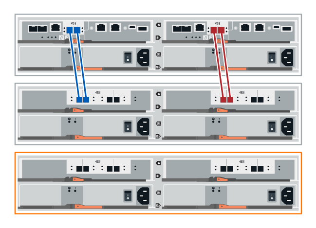

+
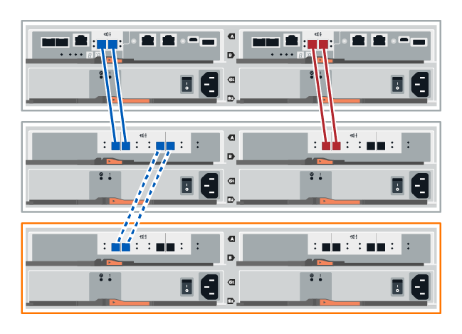

. SANtricity 시스템 관리자에서 * 하드웨어 * 를 클릭합니다.
+

NOTE: 이 절차에서는 컨트롤러 쉘프에 대한 활성 경로가 하나만 있습니다.

. 필요에 따라 아래로 스크롤하여 새 스토리지 시스템의 모든 드라이브 쉘프를 확인합니다. 새 드라이브 쉘프가 표시되지 않으면 연결 문제를 해결하십시오.
. 새 드라이브 쉘프의 * ESM * 아이콘을 선택합니다.
+
image::../media/sam1130_ss_hardware_iom_icon.gif[ESM/IOM 아이콘]

+
Shelf Component Settings * 대화 상자가 나타납니다.

. Shelf Component Settings * 대화 상자에서 * ESM/IOMs * 탭을 선택합니다.
. 더 많은 옵션 표시 * 를 선택하고 다음을 확인합니다.
+
** IOM/ESM A가 나열됩니다.
** SAS-3 드라이브 쉘프의 현재 데이터 속도는 12GBps입니다.
** 카드 통신이 정상입니다.

. 컨트롤러 B에서 모든 확장 케이블을 분리합니다
. 드라이브 쉘프를 컨트롤러 B에 연결합니다
+
다음 그림에서는 추가 드라이브 쉘프와 컨트롤러 B 사이의 연결 예를 보여 줍니다 모델에서 포트를 찾으려면 을 참조하십시오 https://hwu.netapp.com/Controller/Index?platformTypeId=2357027["Hardware Universe"^].

+
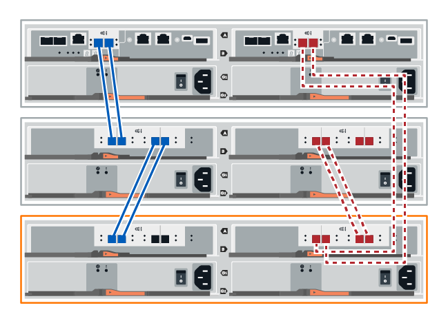

. 아직 선택하지 않은 경우 * Shelf Component Settings * 대화 상자에서 * ESM/IOMs * 탭을 선택한 다음 * Show More options * 를 선택합니다. 카드 통신이 * 예 * 인지 확인합니다.
+

NOTE: Optimal(최적) 상태는 새 드라이브 쉘프와 관련된 이중화 오류가 해결되었으며 스토리지 시스템이 안정화되었음을 나타냅니다.

--
.EF300 또는 EF600용 드라이브 쉘프를 연결합니다
--
드라이브 쉘프를 컨트롤러 A에 연결하고 IOM 상태를 확인한 다음, 드라이브 쉘프를 컨트롤러 B에 연결합니다

.시작하기 전에
* 펌웨어를 최신 버전으로 업데이트했습니다. 펌웨어를 업데이트하려면 의 지침을 따르십시오 link:../upgrade-santricity/index.html["SANtricity OS 업그레이드 중"].

.단계
. 스택의 이전 마지막 쉘프에서 IOM12 포트 1 및 2에서 A 측 컨트롤러 케이블을 모두 분리한 다음 새 쉘프 IOM12 포트 1 및 2에 연결합니다.
+
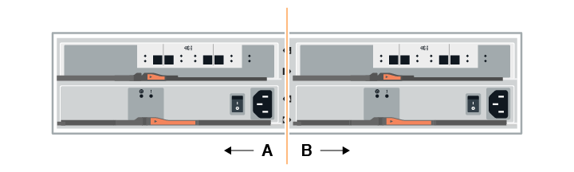

. 케이블을 새 쉘프에서 이전 마지막 셸프 IOM12 포트 1과 2에 있는 A 측 IOM12 포트 3과 4에 연결합니다.
+
다음 그림에서는 추가 드라이브 쉘프와 이전 마지막 쉘프 사이의 연결을 보여 줍니다. 모델에서 포트를 찾으려면 을 참조하십시오 https://hwu.netapp.com/Controller/Index?platformTypeId=2357027["Hardware Universe"^].

+
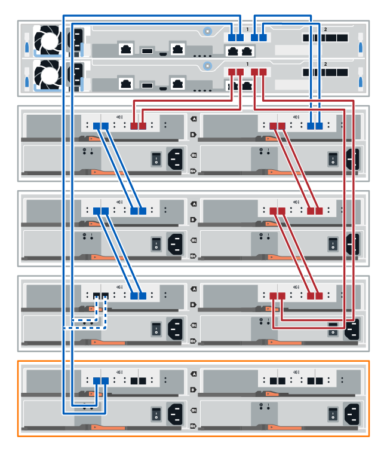

+
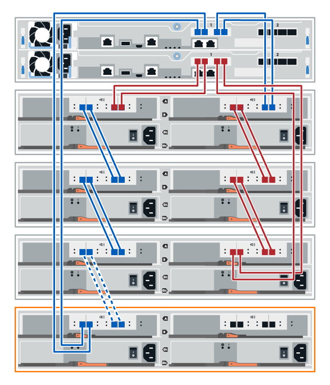

. SANtricity System Manager에서 menu:Hardware[Controllers and components]를 클릭합니다.
+

NOTE: 이 절차에서는 컨트롤러 쉘프에 대한 활성 경로가 하나만 있습니다.

. 필요에 따라 아래로 스크롤하여 새 스토리지 시스템의 모든 드라이브 쉘프를 확인합니다. 새 드라이브 쉘프가 표시되지 않으면 연결 문제를 해결하십시오.
. 새 드라이브 쉘프의 * ESM * 아이콘을 선택합니다.
+
image::../media/sam1130_ss_hardware_iom_icon.gif[ESM/IOM 아이콘]

+
Shelf Component Settings * 대화 상자가 나타납니다.

. Shelf Component Settings * 대화 상자에서 * ESM/IOMs * 탭을 선택합니다.
. 더 많은 옵션 표시 * 를 선택하고 다음을 확인합니다.
+
** IOM/ESM A가 나열됩니다.
** SAS-3 드라이브 쉘프의 현재 데이터 속도는 12GBps입니다.
** 카드 통신이 정상입니다.

. IOM12 포트 1과 2에서 B 측 컨트롤러 케이블을 스택의 이전 마지막 쉘프에서 분리한 다음, 새 쉘프 IOM12 포트 1과 2에 연결합니다.
. 케이블을 새 쉘프의 B측 IOM12 포트 3 및 4와 이전 쉘프 IOM12 포트 1 및 2에 연결합니다.
+
다음 그림에서는 추가 드라이브 쉘프와 이전 마지막 쉘프 사이의 B측 연결을 보여 줍니다. 모델에서 포트를 찾으려면 을 참조하십시오 https://hwu.netapp.com/Controller/Index?platformTypeId=2357027["Hardware Universe"^].

+
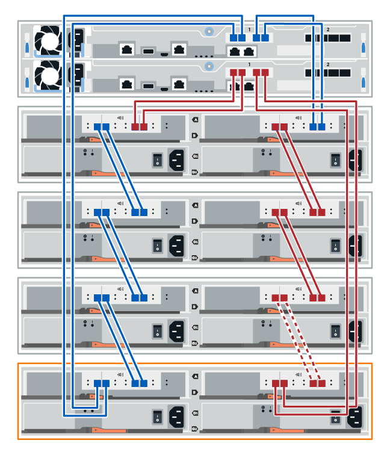

. 아직 선택하지 않은 경우 * Shelf Component Settings * 대화 상자에서 * ESM/IOMs * 탭을 선택한 다음 * Show More options * 를 선택합니다. 카드 통신이 * 예 * 인지 확인합니다.
+

NOTE: Optimal(최적) 상태는 새 드라이브 쉘프와 관련된 이중화 오류가 해결되었으며 스토리지 시스템이 안정화되었음을 나타냅니다.

--
.E4000용 드라이브 쉘프를 연결합니다
--
드라이브 쉘프를 컨트롤러 A에 연결하고 IOM 상태를 확인한 다음, 드라이브 쉘프를 컨트롤러 B에 연결합니다

.단계
. 드라이브 쉘프를 컨트롤러 A에 연결합니다
+
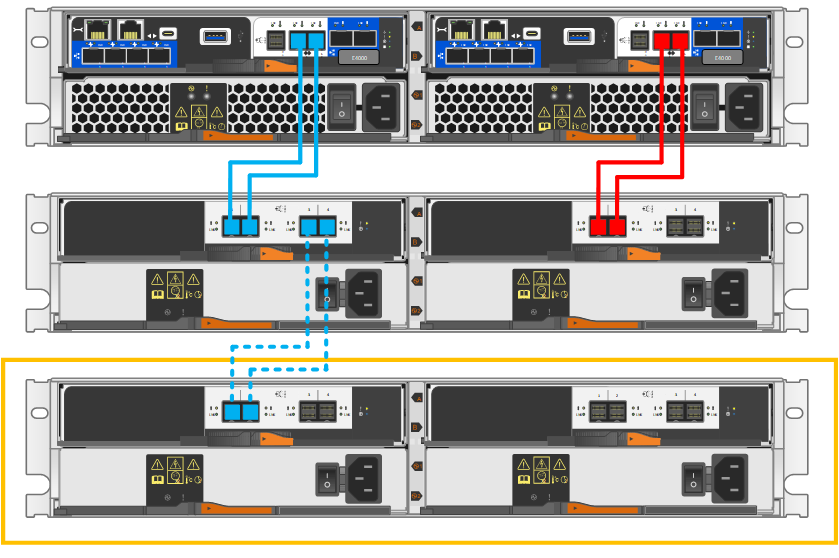

. SANtricity System Manager에서 menu:Hardware[Controllers and components]를 클릭합니다.
+

NOTE: 이 절차에서는 컨트롤러 쉘프에 대한 활성 경로가 하나만 있습니다.

. 필요에 따라 아래로 스크롤하여 새 스토리지 시스템의 모든 드라이브 쉘프를 확인합니다. 새 드라이브 쉘프가 표시되지 않으면 연결 문제를 해결하십시오.
. 새 드라이브 쉘프의 * ESM * 아이콘을 선택합니다.
+
image::../media/sam1130_ss_hardware_iom_icon.gif[IOM 하드웨어 아이콘입니다]

+
Shelf Component Settings * 대화 상자가 나타납니다.

. Shelf Component Settings * 대화 상자에서 * ESM/IOMs * 탭을 선택합니다.
. 더 많은 옵션 표시 * 를 선택하고 다음을 확인합니다.
+
** IOM/ESM A가 나열됩니다.
** SAS-3 드라이브 쉘프의 현재 데이터 속도는 12GBps입니다.
** 카드 통신이 정상입니다.

. 컨트롤러 B에서 모든 확장 케이블을 분리합니다
. 드라이브 쉘프를 컨트롤러 B에 연결합니다
+
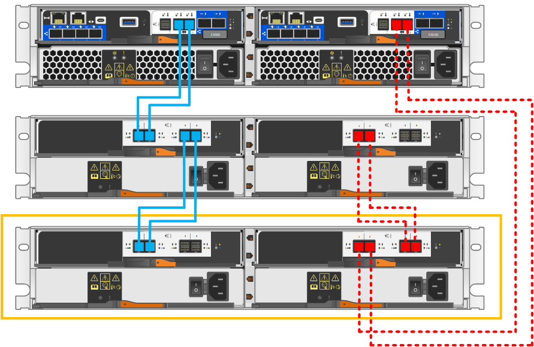

. 아직 선택하지 않은 경우 * Shelf Component Settings * 대화 상자에서 * ESM/IOMs * 탭을 선택한 다음 * Show More options * 를 선택합니다. 카드 통신이 * 예 * 인지 확인합니다.
+

NOTE: Optimal(최적) 상태는 새 드라이브 쉘프와 관련된 이중화 오류가 해결되었으며 스토리지 시스템이 안정화되었음을 나타냅니다.

--
====

[[step-4-assign-drive-shelf-ids]]
== 4단계: 드라이브 셸프 ID 할당

쉘프에 전원을 공급한 다음 각 쉘프에 고유한 쉘프 ID를 할당하십시오.

.이 작업에 대해
* 각 쉘프에 고유한 쉘프 ID를 할당하면 스토리지 시스템 내에서 해당 쉘프가 고유하게 식별됩니다.
+
유효한 쉘프 ID는 01부터 99까지입니다.

+
컨트롤러 내에 통합된 내부 쉘프(스토리지)에는 고정된 쉘프 ID 00이 할당됩니다.

* 쉘프 ID가 적용되려면 쉘프의 전원을 껐다 켜야 합니다(SAS 쉘프의 각 전원 공급 장치에 있는 전원 스위치를 끄고 최소 10초 동안 기다린 후 전원을 다시 켜십시오).

.단계
. 왼쪽 끝 캡을 제거하여 전면 패널의 주황색 쉘프 ID 버튼에 접근합니다.
+
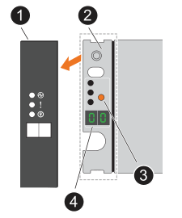

+
[cols="20%,80%"]
|===

 a| 

 a| 
선반 끝 덮개

 a| 
image::../media/icon_round_2.png[설명선 번호 2]
 a| 
쉘프 전면판

 a| 
image::../media/icon_round_3.png[[호출 번호 3]
 a| 
쉘프 ID 버튼

 a| 
image::../media/icon_round_4.png[[호출 번호 4]
 a| 
쉘프 ID 번호

|===
. 쉘프 ID의 첫 번째 숫자를 변경합니다.
+
.. 쉘프 ID 버튼을 디지털 디스플레이의 첫 번째 숫자가 깜빡일 때까지 길게 누른 다음 버튼에서 손을 떼십시오.
+
숫자가 깜빡이는 데 최대 15초가 걸릴 수 있습니다. 이렇게 하면 쉘프 ID 프로그래밍 모드가 활성화됩니다.

+

NOTE: ID가 깜빡이는 데 15초 이상 걸리는 경우 쉘프 ID 버튼을 다시 길게 눌러 끝까지 완전히 눌렸는지 확인하십시오.

.. 쉘프 ID 버튼을 눌렀다 놓으면 0부터 9까지 원하는 숫자가 나올 때까지 숫자가 올라갑니다.
+
버튼을 누르고 놓는 각 동작의 지속 시간은 1초 정도로 짧을 수 있습니다.

+
첫 번째 숫자가 계속 깜빡입니다.

. 쉘프 ID의 두 번째 숫자를 변경합니다.
+
.. 디지털 디스플레이의 두 번째 숫자가 깜빡일 때까지 버튼을 길게 누르십시오.
+
숫자가 깜빡이는 데 최대 3초가 걸릴 수 있습니다.

+
디지털 디스플레이의 첫 번째 숫자가 깜빡임을 멈춥니다.

.. 쉘프 ID 버튼을 눌렀다 놓으면 0부터 9까지 원하는 숫자가 나올 때까지 숫자가 올라갑니다.
+
두 번째 숫자가 계속 깜빡입니다.

. 원하는 번호를 고정하고 두 번째 숫자가 깜빡임을 멈출 때까지 쉘프 ID 버튼을 길게 눌러 프로그래밍 모드를 종료하십시오.
+
숫자가 깜빡임을 멈추는 데 최대 3초가 걸릴 수 있습니다.

+
디지털 디스플레이의 두 숫자가 모두 깜빡이기 시작하고 약 5초 후 주황색 LED가 켜지면서 보류 중인 쉘프 ID가 아직 적용되지 않았음을 알려줍니다.

. 셸프 ID가 적용되도록 셸프의 전원을 최소 10초 동안 껐다 켜십시오.
+
.. 각 전원 공급 장치의 전원 스위치를 끄십시오.
.. 10초 기다립니다.
.. 각 전원 공급 장치의 전원 스위치를 켜서 전원 사이클을 완료하십시오.
+
전원 공급 장치가 켜지면 이중 색상 LED가 녹색으로 켜져야 합니다.

. 왼쪽 끝 덮개를 교체하십시오.

[[step-5-complete-the-hot-add]]
== 5단계: 핫애드 완료

오류가 있는지 확인하고 새로 추가된 드라이브 쉘프에서 최신 펌웨어를 사용하는지 확인하여 핫 애드 기능을 완료합니다.

.단계
. SANtricity 시스템 관리자에서 * 홈 * 을 클릭합니다.
. 페이지 상단 중앙에 * Recover from Problems * 라는 링크가 표시되면 링크를 클릭하여 Recovery Guru에 표시된 문제를 해결합니다.
. SANtricity System Manager에서 메뉴:하드웨어[컨트롤러 및 구성 요소]를 클릭하고 필요에 따라 아래로 스크롤하여 새로 추가된 드라이브 셸프를 확인하십시오.
. 이전에 다른 스토리지 시스템에 설치된 드라이브의 경우, 새로 설치된 드라이브 쉘프에 드라이브를 한 번에 하나씩 추가합니다. 다음 드라이브를 삽입하기 전에 각 드라이브가 인식될 때까지 기다립니다.
+
스토리지 시스템에서 드라이브를 인식하면 * Hardware * 페이지의 드라이브 슬롯이 파란색 직사각형으로 표시됩니다.

. 지원 * > * 지원 센터 * > * 지원 리소스 * 탭을 선택합니다.
. 소프트웨어 및 펌웨어 인벤토리 * 링크를 클릭하고 새 드라이브 쉘프에 설치된 IOM/ESM 펌웨어 및 드라이브 펌웨어의 버전을 확인합니다.
+

NOTE: 이 링크를 찾으려면 페이지를 아래로 스크롤해야 할 수 있습니다.

. 필요한 경우 드라이브 펌웨어를 업그레이드합니다.
+
업그레이드 기능을 해제하지 않으면 IOM/ESM 펌웨어가 최신 버전으로 자동 업그레이드됩니다.

.다음 단계
핫 애드 절차가 완료되었습니다. 일반 작업을 다시 시작할 수 있습니다.
