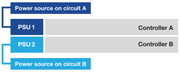

= EF50 및 EF80 스토리지 시스템의 하드웨어 전원 켜기
:allow-uri-read: 
:icons: font
:imagesdir: ../media/

[role="lead"]
EF50 또는 EF80 스토리지 시스템의 케이블을 연결한 후 쉘프의 전원을 켜고 (해당되는 경우) 쉘프 ID를 할당한 다음 컨트롤러의 전원을 켭니다.

.시작하기 전에
정전기 방지 예방 조치를 취하십시오.

[[step-1-power-on-the-shelves-and-assign-shelf-ids]]
== 1단계: 선반의 전원을 켜고 선반 ID를 할당합니다.

쉘프에 전원을 공급한 다음 각 쉘프에 고유한 쉘프 ID를 할당하십시오.

.이 작업에 대해
* 각 쉘프에 고유한 쉘프 ID를 할당하면 스토리지 시스템 내에서 해당 쉘프가 고유하게 식별됩니다.
+
유효한 쉘프 ID는 01부터 99까지입니다.

+
컨트롤러 내에 통합된 내부 쉘프(스토리지)에는 고정된 쉘프 ID 00이 할당됩니다.

* 쉘프 ID가 적용되려면 쉘프의 전원을 껐다 켜야 합니다(SAS 쉘프의 각 전원 공급 장치에 있는 전원 스위치를 끄고 최소 10초 동안 기다린 후 전원을 다시 켜십시오).

.단계
. 선반에 전원을 공급하려면 먼저 전원 코드를 선반에 연결하고 전원 코드 고정 장치로 고정한 다음, 각 전원 코드를 서로 다른 회로의 전원에 연결하고 마지막으로 각 전원 공급 장치(선반 뒷면에 있음)의 전원 스위치를 켜십시오.
+
선반은 전원이 켜지면 자동으로 전원이 켜지고 부팅됩니다.

. 왼쪽 끝 캡을 제거하여 전면 패널의 주황색 쉘프 ID 버튼에 접근합니다.
+
image::../media/drw_shelf_id_sas_ieops-2187.svg[SAS 쉘프 ID 변경]

+
[cols="20%,80%"]
|===

 a| 
image::../media/icon_round_1.png[설명선 번호 1]
 a| 
선반 끝 덮개

 a| 
image::../media/icon_round_2.png[설명선 번호 2]
 a| 
쉘프 전면판

 a| 
image::../media/icon_round_3.png[[호출 번호 3]
 a| 
쉘프 ID 버튼

 a| 
image::../media/icon_round_4.png[[호출 번호 4]
 a| 
쉘프 ID 번호

|===
. 쉘프 ID의 첫 번째 숫자를 변경합니다.
+
.. 쉘프 ID 버튼을 디지털 디스플레이의 첫 번째 숫자가 깜빡일 때까지 길게 누른 다음 버튼에서 손을 떼십시오.
+
숫자가 깜빡이는 데 최대 15초가 걸릴 수 있습니다. 이렇게 하면 쉘프 ID 프로그래밍 모드가 활성화됩니다.

+

NOTE: ID가 깜빡이는 데 15초 이상 걸리는 경우 쉘프 ID 버튼을 다시 길게 눌러 끝까지 완전히 눌렸는지 확인하십시오.

.. 쉘프 ID 버튼을 눌렀다 놓으면 0부터 9까지 원하는 숫자가 나올 때까지 숫자가 올라갑니다.
+
버튼을 누르고 놓는 각 동작의 지속 시간은 1초 정도로 짧을 수 있습니다.

+
첫 번째 숫자가 계속 깜빡입니다.

. 쉘프 ID의 두 번째 숫자를 변경합니다.
+
.. 디지털 디스플레이의 두 번째 숫자가 깜빡일 때까지 버튼을 길게 누르십시오.
+
숫자가 깜빡이는 데 최대 3초가 걸릴 수 있습니다.

+
디지털 디스플레이의 첫 번째 숫자가 깜빡임을 멈춥니다.

.. 쉘프 ID 버튼을 눌렀다 놓으면 0부터 9까지 원하는 숫자가 나올 때까지 숫자가 올라갑니다.
+
두 번째 숫자가 계속 깜빡입니다.

. 원하는 번호를 고정하고 두 번째 숫자가 깜빡임을 멈출 때까지 쉘프 ID 버튼을 길게 눌러 프로그래밍 모드를 종료하십시오.
+
숫자가 깜빡임을 멈추는 데 최대 3초가 걸릴 수 있습니다.

+
디지털 디스플레이의 두 숫자가 모두 깜빡이기 시작하고 약 5초 후 주황색 LED가 켜지면서 보류 중인 쉘프 ID가 아직 적용되지 않았음을 알려줍니다.

. 셸프 ID가 적용되도록 셸프의 전원을 최소 10초 동안 껐다 켜십시오.
+
.. 각 전원 공급 장치의 전원 스위치를 끄십시오.
.. 10초 기다립니다.
.. 각 전원 공급 장치의 전원 스위치를 켜서 전원 사이클을 완료하십시오.
+
전원 공급 장치가 켜지면 이중 색상 LED가 녹색으로 켜져야 합니다.

. 왼쪽 끝 덮개를 교체하십시오.

[[step-2-power-on-the-controllers]]
== 2단계: 컨트롤러 전원 켜기

선반의 전원을 켜고 고유 ID를 할당한 후에는 컨트롤러의 전원을 켜십시오.

. 각 컨트롤러 전원 공급 장치에 전원 케이블을 연결한 다음, 서로 다른 회로의 전원에 연결하십시오.
+

NOTE: 타사 PDU(전원 분배 장치)를 사용하는 경우 컨트롤러 바로 뒤에 있는 전원 콘센트를 사용하지 마십시오. 컨트롤러에 대한 액세스가 차단될 수 있습니다.

+
* 전원 케이블 *

+

+

+
** 시스템 부팅이 시작됩니다. 초기 부팅에는 최대 8분이 소요될 수 있습니다.
** 시스템 섀시의 LED가 깜빡이고 팬이 작동하기 시작하면 컨트롤러에 전원이 공급되고 있음을 나타냅니다.
+
시동 초기에는 팬 소음이 매우 큰 것이 정상입니다.

** 시스템 섀시 전면(베젤 뒤)의 디지털 디스플레이에 불이 들어오지 않습니다.

. 각 전원 공급 장치의 고정 장치를 사용하여 전원 코드를 고정합니다.

.다음 단계
스토리지 시스템의 전원을 켠 후 link:install-complete-setup.html["전체 스토리지 시스템 설정"].
